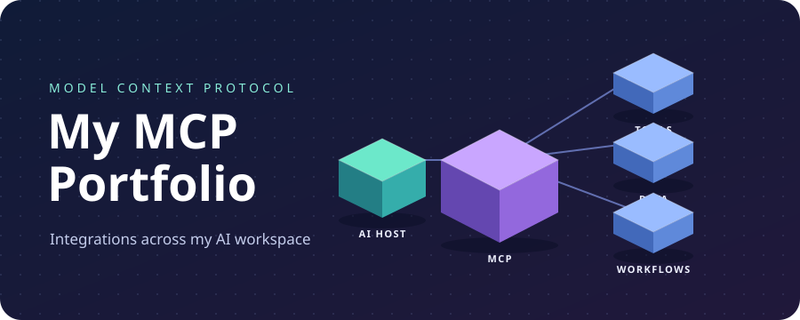

  

# My MCP Portfolio

A look at the Model Context Protocol integrations in my AI workspace, spanning design, development, automation, and LLM observability.

## What is MCP?

The **Model Context Protocol (MCP)** is an open standard that lets AI applications connect to external systems. An MCP server can expose tools an assistant can call, resources it can read, and prompts it can reuse.

## Integrations in my workspace

| Area | Connected integrations |
| --- | --- |
| Design and media | Figma, Higgsfield, MotionSites |
| Development and deployment | Origin, TestSprite, Vercel |
| Data and backend | Firebase, Supabase, LlamaParse |
| AI and observability | Hugging Face (`hf-mcp-server`), Langfuse, Langfuse Docs |
| Automation and productivity | n8n, Computer Use, Gmail, Cal.com |

**Setup in progress.** GitHub showed a connection error. Google Calendar and Google Docs were awaiting authentication.

## What these integrations make possible

- **Design to deployment.** Use Figma as design context, TestSprite for testing, and Vercel for deployment.
- **LLM debugging.** Inspect traces with Langfuse and use Langfuse Docs to look up instrumentation guidance.
- **Workflow automation.** Use n8n to coordinate steps across tools and Computer Use to handle tasks that need a browser interface.

These are example workflows for the integrations listed above.

## Learn and explore

- [Everything you need to know about MCP](https://modelcontextprotocol.io/docs/2026-07-28/getting-started/intro) — the official introduction to the protocol.
- [List of MCP servers](https://mcpservers.org/) — a searchable directory of integrations.
